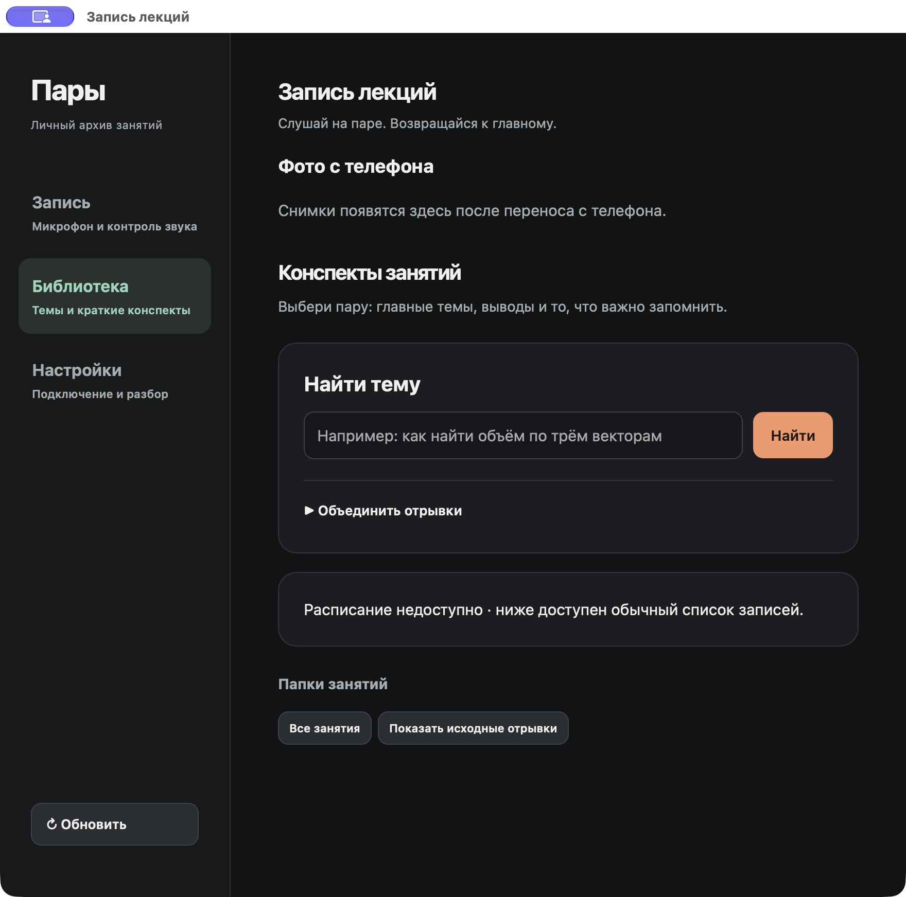
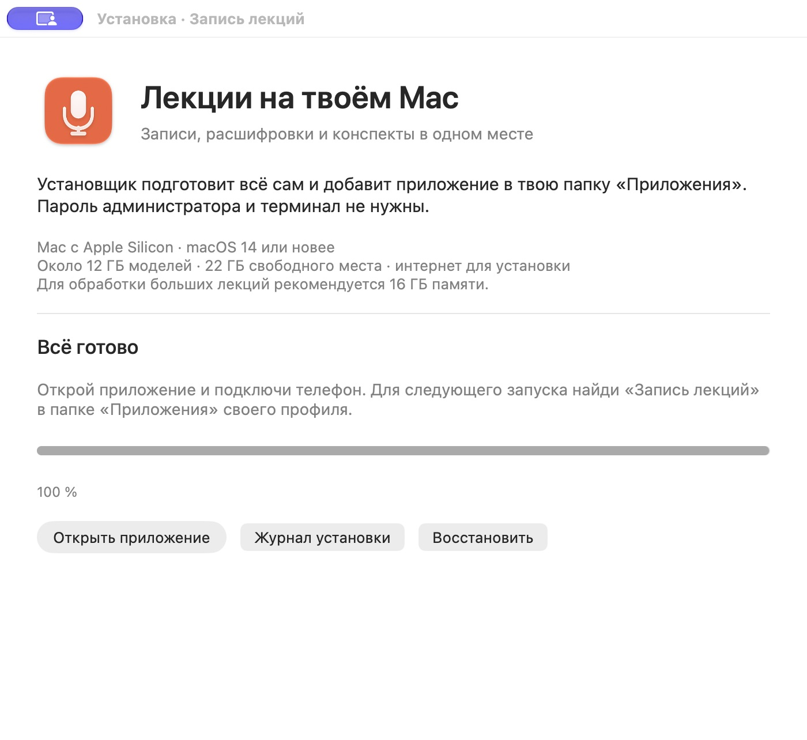

<div align="center">

# Запись лекций

**Слушай на паре. Возвращайся к главному.**

Запись лекций, текст с таймкодами и конспект на Android и Mac.


[**Скачать для Mac**](https://github.com/lecture-recorder-ilya/lecture-recorder-esp32-s3/releases/download/v0.5.11/lecture-recorder-0.5.11-arm64.dmg) · [**Скачать для Android**](https://github.com/lecture-recorder-ilya/lecture-recorder-esp32-s3/releases/download/v0.5.11/lecture-recorder.apk) · [Изменения 0.5.11](CHANGELOG.md)

</div>

## Первая запись

- **На Android** установи APK. Нажми **Начать запись** или **Импорт аудио** на первом экране. Открой записанную пару и нажми **Разобрать запись**. После первой загрузки моделей можно работать без интернета.
- **На Mac** открой DMG и нажми **Установить и открыть**. В библиотеке выбери аудиозапись, укажи предмет и дату, нажми **Загрузить и подготовить конспект**.
- **Для общей библиотеки** открой подключение в настройках телефона и Mac, введи код и сравни цифры. Для записи также можно подключить микрофон ESP32-S3.

| Платформа | Что потребуется |
| --- | --- |
| Android | Android 8 или новее. Для локального разбора нужен 64-битный процесс, при первом запуске загружается до 570 МБ моделей. |
| Mac | Apple Silicon, macOS 14 или новее, 22 ГБ свободного места. При первой установке загружается около 12 ГБ моделей. |

[Установка](INSTALL.md) · [Подключение телефона](PAIRING.md) · [Обновления](UPDATES.md) · [Распознавание и проверка качества](ASR.md) · [Очистка звука](AUDIO.md) · [Приложения телефона](MOBILE.md) · [Планы продукта](PRODUCT.md) · [Плата диктофона v0.1](hardware/v0.1/README.md) · [Корпус-карточка v0.2](hardware/v0.2/README.md)

DMG подписан локально. Репозиторий закрытый. Для автообновления Mac войди в GitHub в **Настройки → Обновления**. Сопряжённый телефон получит APK через Mac. На отдельном Android включи **Получать обновления без Mac** в настройках и один раз подтверди вход на GitHub. Для установки нажми кнопку в системном окне Android. [Установка](INSTALL.md) · [Обновления](UPDATES.md)

<p align="center"></p>

<details>
<summary>Установщик Mac</summary>



</details>

## Запись пары → текст → конспект

На Mac открой **Библиотека → Загрузить запись пары**. Приложение сохраняет исходный файл, готовит аудио для распознавания и показывает ход обработки. Текст появляется до завершения конспекта; результат обновляется автоматически.

- **Текст** — фразы с таймкодами, поиск, скорость воспроизведения и переход в аудио по нажатию.
- **Проверить** — неуверенно распознанные или уточнённые по контексту места. Прослушай их и нажми **Проверено по записи**. Если повторное распознавание изменит фразу, её проверяют заново.
- **Конспект** — главное за пару, ключевые мысли, темы по времени, формулы и задания со ссылками на исходные фразы. Доступно скачивание Markdown и полного текста с таймкодами.

Сигналы распознавания помогают найти часть ошибок, но не являются гарантией. Отсутствие отметок не означает, что текст безошибочен. Для старых расшифровок без оценки качества это указано отдельно.

На 64-битном Android выбери запись и нажми **Разобрать запись**. Телефон покажет первые готовые фразы с таймкодами, пока распознаёт остальную лекцию. Можно также передать запись на сопряжённый Mac и получить его текст и конспект при синхронизации. По умолчанию телефон сохраняет аудиокопию для прослушивания, около 115 МБ на час. Отметки проверки хранятся на телефоне.

## Возможности

- Запись на Mac по USB или Wi-Fi; автоматическое восстановление соединения по Wi-Fi.
- Запись на Android по Wi-Fi/Bluetooth; хранение файлов на телефоне до подтверждённого переноса на Mac.
- Сопряжение Android с Mac по коду и подтверждению на обоих экранах, без ручной настройки файлов.
- Синхронизация с повторными попытками по файлам, продолжением прерванного WAV и переходом между каналами.
- Передача USB/LAN/Bluetooth: проверка размера, SHA-256 и WAV, очистка очереди только после подтверждения сохранённой копии; аудио для прослушивания можно оставить на телефоне.
- Автоматический выбор GigaAM v3 или Whisper, контекст на границах блоков и кэш с проверкой аудио/модели/терминов.
- Локальное распознавание GigaAM v3 + Silero VAD; контекстная самопроверка Qwen2.5-7B на четырёх соседних фрагментах с сохранением исходного текста.
- Сбор полной произнесённой формулы из нескольких фраз и отображение через KaTeX.
- Предмет, преподаватель, тема, конспект, ДЗ, метки и разделы занятия; отдельное личное расписание.
- Тёмный интерфейс, оранжевые кнопки, нативное окно и иконка Dock.
- Установщик Mac с собственным Python: компоненты и локальные модели устанавливаются через окно приложения, доступны пауза и восстановление.
- Копирование конспекта/полной лекции для Telegram: аккуратный текст, части до 3900 символов и единый текстовый файл. Ничего не отправляется автоматически.

Самопроверка не восстанавливает слова, которые не слышны в исходном звуке. Точность полной лекции требует проверки на реальных записях. Беспроводной перенос на телефон после последних изменений ещё требует проверки на устройстве.

## Автообновления

Добавлены обновление открытых текстов на Mac, синхронизация расшифровок обратно на Android и проверка новых версий приложений через GitHub Releases. На Android установку APK подтверждает пользователь. Настройка канала, сборка релиза и ограничения: [UPDATES.md](UPDATES.md).

## Подключение телефона

Открой на Mac **Настройки → Телефон и Mac → Подключить телефон**, а на Android — **Подключить Mac**. Устройства должны быть в одной Wi-Fi сети. Выбери найденный Mac, введи его 12-символьный код, сравни 6 цифр на экранах и подтверди подключение на Mac. Настройки сохраняются автоматически; ESP для сопряжения не нужна. Порядок подключения, смена устройства и помощь с сетью: [PAIRING.md](PAIRING.md).

## Установка на Mac

Открой `lecture-recorder-0.5.11-arm64.dmg`, запусти **Установить Запись лекций** и нажми **Установить и открыть**. Установщик подготовит Python, зависимости и модели, проверит их и откроет приложение. Следующие запуски доступны через **Запись лекций** в папке **Приложения** твоего профиля. Терминал и пароль администратора не нужны.

Нужны Apple Silicon, macOS 14+, 22 ГБ свободного места и интернет для первой установки; загружается около 12 ГБ моделей. Доступны пауза, продолжение загрузки и восстановление без замены библиотеки. Текущая сборка подписана локально; для публичного распространения ещё нужны Developer ID и notarization Apple. Подробности: [INSTALL.md](INSTALL.md).

План улучшений интерфейса, записи без ESP, разбора и надёжности: [PRODUCT.md](PRODUCT.md).

## Структура

| Папка | Содержимое |
| --- | --- |
| `outputs/recorder` | Сервисы Mac, интерфейс, распознавание и обработка |
| `outputs/microphone-firmware` | Прошивка ESP32-S3, PlatformIO |
| `hardware/v0.1` | ТЗ собственной платы, структурная схема, предварительные GPIO и BOM |
| `hardware/v0.2` | Корпус-карточка FreeCAD, STL для пробной печати и новый контур платы |
| `outputs/android` | Android-приложение на Java и сборка APK |
| `macos` | Swift-приложения и шаблоны bundle |
| `installer` | Мастер установки, проверка компонентов, манифесты моделей и зависимости |
| `tools` | Установка окружения, загрузка моделей и сборка Mac |
| `work/test_*.py` | Проверки аудиозаписи, обработки, интерфейса и переноса |

## Запуск из исходников

Нужны Apple Silicon, Python 3.12 и Xcode Command Line Tools. Из корня проекта:

```sh
python3.12 tools/setup_mac.py
work/ai-env/bin/python tools/download_models.py
work/vision-env/bin/python tools/download_board_model.py
python3 tools/build_mac.py
open 'outputs/Запись лекций.app'
```

На Samsung кнопка «Фото доски» открывает камеру. Снимок и время съёмки сохраняются на телефоне; при подключении к Mac автоматический перенос проверяет копию перед очисткой телефона. Qwen3-VL-4B в отдельном окружении читает надписи, формулы и графики локально. Mac привязывает снимок к текущей записи или времени съёмки и уточняет момент по соседним строкам расшифровки. Если занятие нельзя определить однозначно, снимок остаётся в разделе «Фото с телефона»: можно выбрать занятие и момент вручную. Фото и распознанные формулы доступны внутри лекции. Размытые и сомнительные формулы могут быть пропущены; исходный снимок остаётся доступен.

Модели скачиваются отдельно с Hugging Face и затем работают локально. Вес моделей не хранится в Git. Дополнительные модели поиска/разделения голосов можно скачать через `work/download_study_models.py`.

При запуске из исходников приложение оставляют в `outputs`: расположение используется для поиска окружения и сервисов. Установщик сам создаёт управляемую копию и ярлык. Сервис записи — порт 8765, интерфейс — 8767, учебный сервис — 8768. Обновление интерфейса не останавливает запись. Mac должен оставаться включённым для захвата и обработки.

Личное расписание размещается в `outputs/recorder/schedule.json` по структуре `schedule.example.json`; без него запись работает вне расписания.

## ESP и Android

Прошивка собирается из `outputs/microphone-firmware` через PlatformIO. GPIO микрофона и параметры платы заданы в `src/main.cpp` и `platformio.ini`; перед прошивкой сверяют их с конкретной платой.

Для Android нужны JDK 17, Android SDK 36 и Build Tools. `outputs/android/build.py` поддерживает `JAVA_HOME`, `ANDROID_SDK_ROOT` и `ANDROID_BUILD_TOOLS`; локальная исходная структура `work/android-tools` также поддерживается. Сборка:

```sh
python3 outputs/android/build.py
```

Ключ подписи создаётся локально и не загружается в Git. Сохраняйте свой ключ: он нужен для последующих обновлений установленного APK. Настройки телефона создаёт мастер сопряжения. ESP настраивается отдельно на Mac; уже сохранённый адрес и токен передаются телефону при сопряжении.

## Проверки

```sh
work/ai-env/bin/python work/test_context_review.py
work/ai-env/bin/python work/test_math_formulas.py
work/ai-env/bin/python work/test_qwen_pipeline.py
work/ai-env/bin/python work/test_preview_history.py
work/ai-env/bin/python work/test_live_draft.py
work/ai-env/bin/python work/test_phone_sync.py
work/ai-env/bin/python work/test_phone_retries.py
work/ai-env/bin/python work/test_phone_pairing.py
work/ai-env/bin/python work/test_asr_pipeline.py
work/ai-env/bin/python work/test_updates.py
work/ai-env/bin/python work/test_installer.py
```

Для Java-проверки TLS внутри `test_phone_pairing.py` нужен JDK; можно указать `JAVA_HOME`. Некоторые аппаратные/акустические проверки используют локальные устройства или личные WAV-фрагменты; эти данные не включены в репозиторий.

## Личные данные

Исходные записи, расшифровки, расписание, ключи подписи, токены подключения, пароли, модели, журналы и временные файлы остаются локальными. `.gitignore` исключает их из загрузки. KaTeX и другие внешние зависимости сохраняют свои лицензии.
