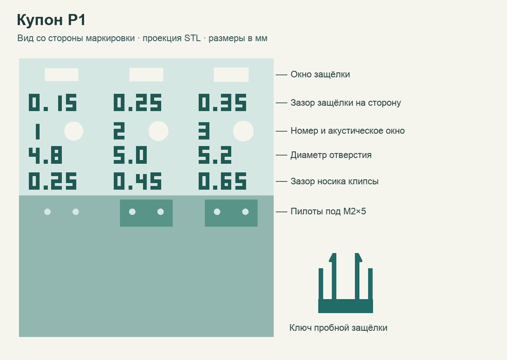

# Печатный купон P1

Печатать [купон](P1-coupon.stl) плоской стороной вниз и [пружинный ключ](Snap-key.stl) плашмя. Для проверки крепления к одежде напечатать одну [штатную клипсу](../print/Clip.stl) на боку с каймой 5 мм. Материал и параметры принтера взять те же, что для корпуса. На купоне три колонки. Номер напечатан рельефом рядом с круглым отверстием. Под номером сверху вниз читаются диаметр окна и зазор носика, рядом с прямоугольным окном — зазор защёлки на сторону. Все числа в мм, высота цифр 4,2, штрих 0,8, рельеф 0,6.

| № | Круглое окно в стенке 1,6 | Зазор носика клипсы | Зазор защёлки на сторону | Прямоугольное окно |
|---|---:|---:|---:|---|
| 1 | 4,8 | 0,25 | 0,15 | 8,30 × 3,30 |
| 2 | 5,0 | 0,45 | 0,25 | 8,50 × 3,50 |
| 3 | 5,2 | 0,65 | 0,35 | 8,70 × 3,70 |

1. Проверить читаемость номера и всех трёх размеров. Измерить отверстия в двух направлениях калибрами или измерительным микроскопом. Сохранить фото и фактические размеры. Штатный диаметр P1 — 5,0.
2. Для одежды переставлять одну клипсу и два M2×5 по трём площадкам. Направить носик к краю без надписей. Проверить щупами исходный просвет и измерить усилие срыва на одной полосе ткани до и после 100 циклов. Разница между станциями задана высотой основания пятки. Штатный зазор P1 — 0,25.
3. Для **пробной защёлки крышки** вставлять один двухлапый ключ перпендикулярно прямоугольному окну до боковых упоров. Длина гибкого плеча до уступа 11, толщина плеча 1,2, осевой люфт 0,4. Расчётное перекрытие каждого зацепа 0,70 / 0,60 / 0,50. Для освобождения сжать концы лапок с обратной стороны. На трёх отдельных ключах одного тиража измерить усилия вставки и извлечения, осмотреть корни после 10 и 100 циклов. Сопоставить варианты при одной ориентации слоёв. В текущей модели P1 крышка крепится винтами; ключ проверяет возможную замену крепления для следующей итерации.

**Цифровая проверка.** Генератор FreeCAD проверяет три зазора до штатной клипсы и отсутствие пересечений ключа в замкнутом положении. В обоих STL по одному замкнутому телу. PrusaSlicer 2.9.6 при сопле 0,4 и слое 0,2 нарезал купон 63 × 69 × 4,4 за 22 слоя, ключ 16 × 17,5 × 3 за 15 слоёв, без поддержек. Усилие, ресурс и читаемость на конкретном принтере предстоит измерить. [Генератор и проверки](build_coupon.py)
